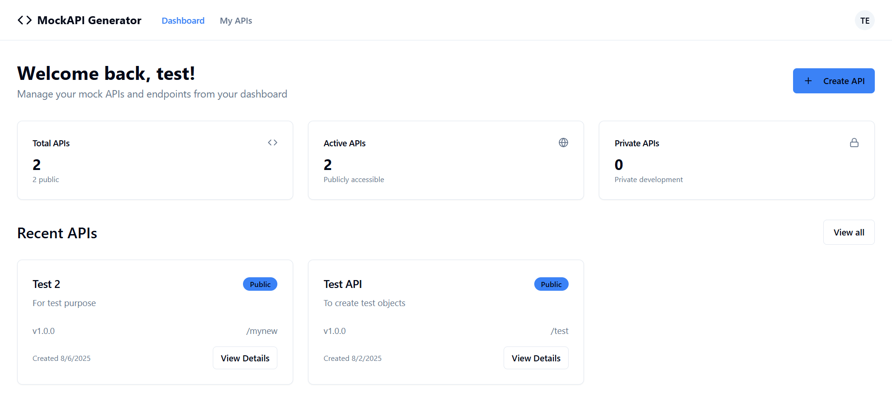
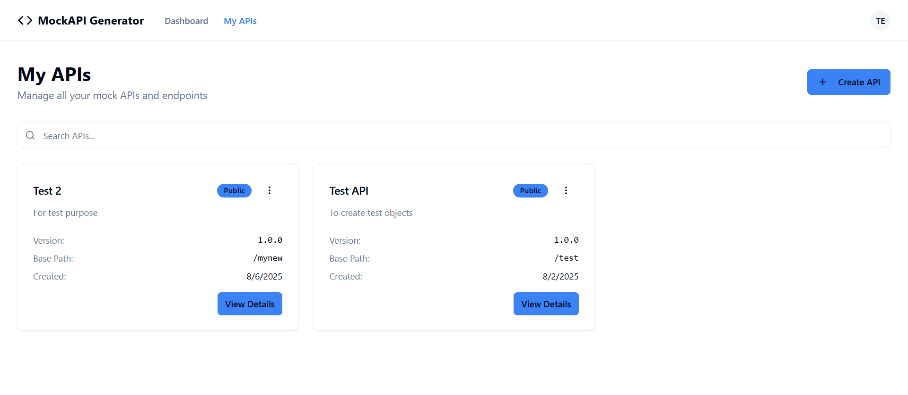
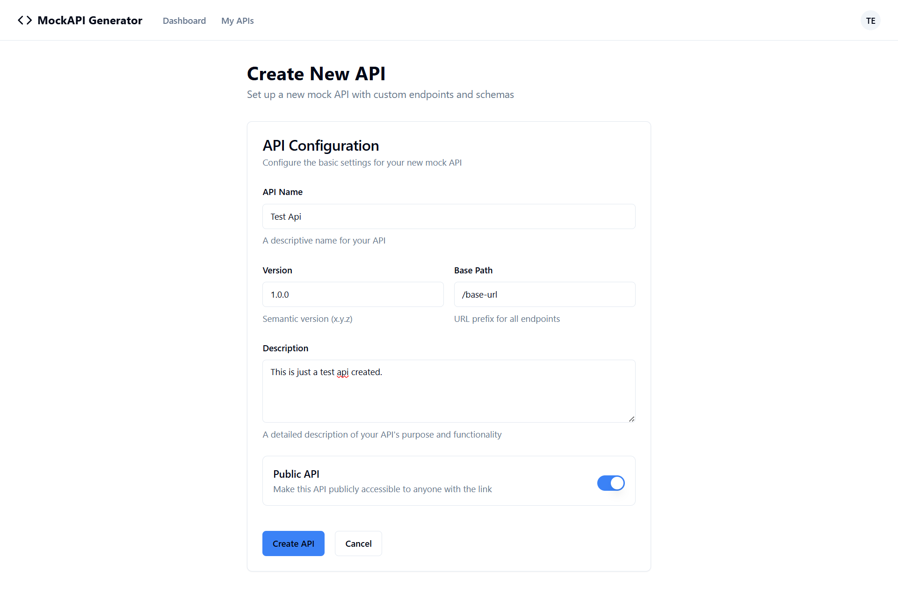
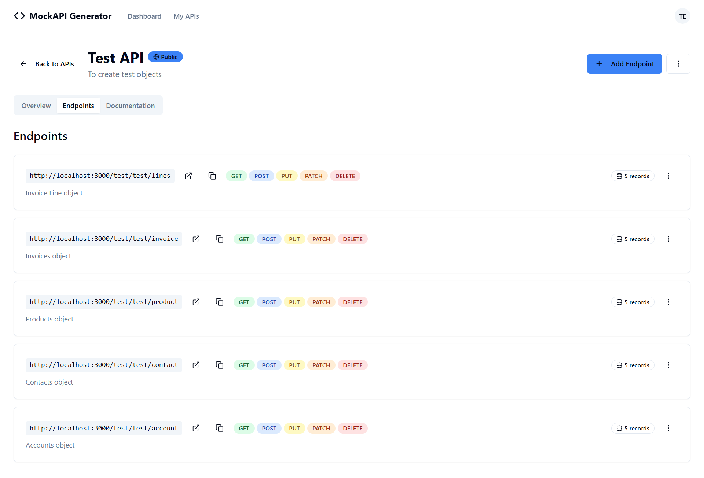
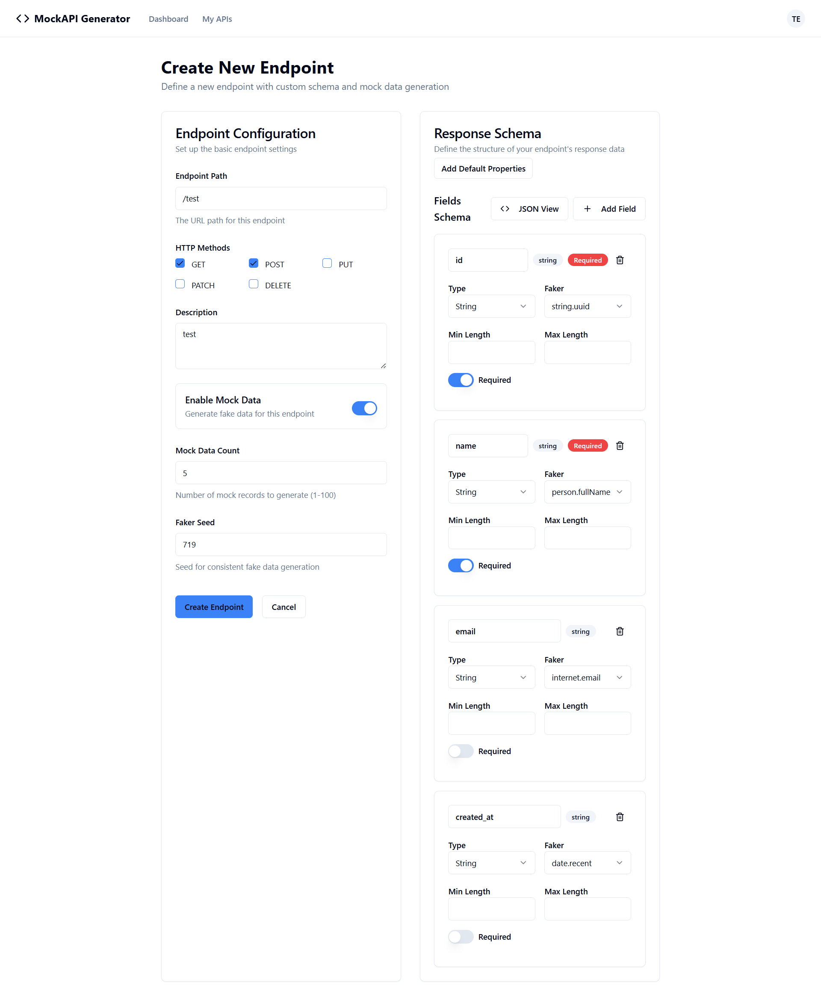
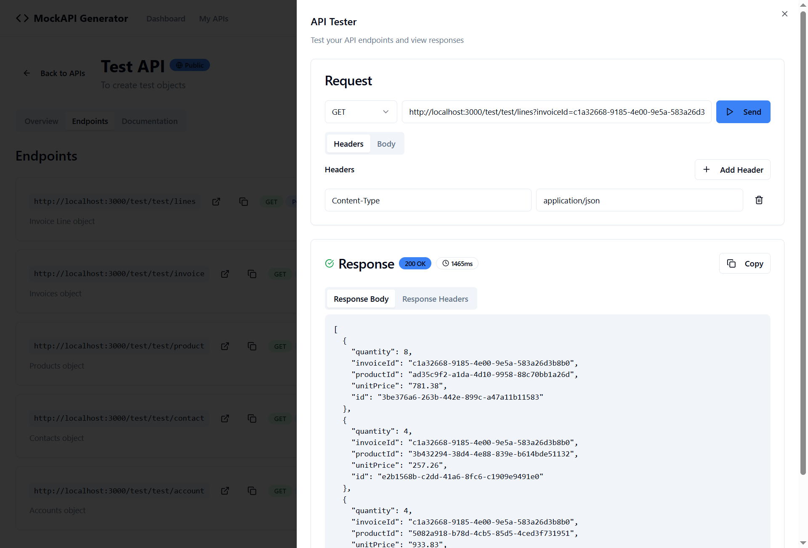
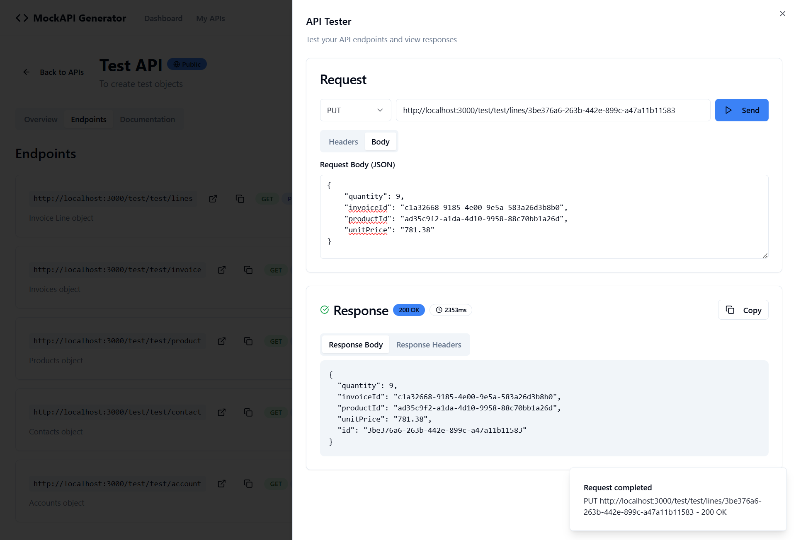
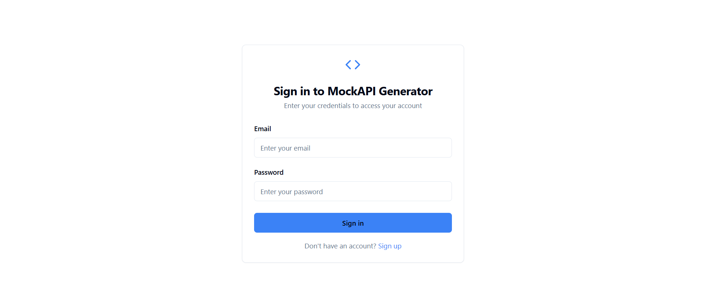
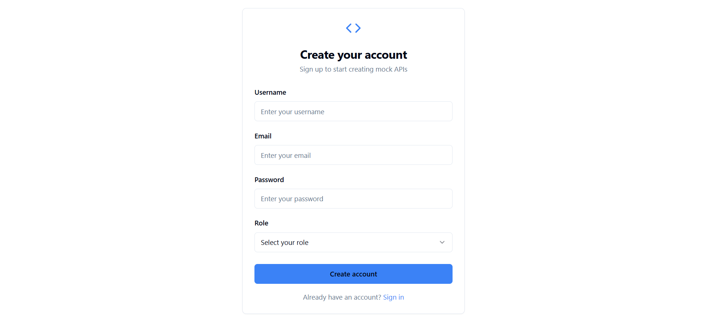

# Mock API Generator
**Build, manage, test and share production-grade mock APIs in minutes — no backend required.**

Perfect for frontend devs, prototyping, QA, and simulating real-world APIs while the real backend catches up.


[](https://github.com/IbrahimNazir/mock-api-generator)
[](https://github.com/IbrahimNazir/mock-api-generator)
[](https://opensource.org/licenses/MIT)
[](https://www.typescriptlang.org/)
[](https://react.dev/)

---
## **[Live Demo](https://mock-api-generator.onrender.com)**

## Table of Contents

- [Key Features](#key-features)
- [UI Walkthrough & Experience](#ui-walkthrough--experience)
  - [Dashboard & Analytics](#dashboard--analytics)
  - [API Management](#api-management)
  - [Endpoint Management](#endpoint-management)
  - [Built-in API Testing Tool](#built-in-api-testing-tool)
  - [Authentication & Security](#authentication--security)
- [Query Parameters for Mock API Endpoints](#query-parameters-for-mock-api-endpoints)
  - [Supported Query Parameters](#supported-query-parameters)
  - [Filtering – Bracket Notation](#filtering--bracket-notation)
  - [Sorting](#sorting)
  - [Pagination](#pagination)
  - [API Versioning](#api-versioning)
  - [ETags & Conditional Requests](#etags--conditional-requests)
  - [Rate Limits](#rate-limits)
- [Backend Design](#backend-design)
- [Tech Stack](#tech-stack)
- [Installation & Setup](#installation--setup)
- [Usage](#usage)
- [Contributing](#contributing)
  
## Key Features

- **Smart Filtering**  
  Filter API responses by any field → get exactly the data slice you need for different test scenarios

- **Built-in Pagination — 4 styles**  
  Page-number, offset, opaque **cursor** and keyset (`after_id`/`before_id`) pagination with `Link` headers, totals and navigation links — pick the style per request or per endpoint

- **API Versioning**  
  Run several versions of one mock API side by side and select them via query (`?api-version=2`), headers (`X-API-Version`, `Accept: application/vnd.mock-api.v2+json`) or request body; deprecation & sunset headers included

- **ETags & Conditional Requests**  
  `ETag` on every response, `If-None-Match` → `304`, `If-Match` → `412` for optimistic concurrency

- **Rate Limiting**  
  Per-IP and per-API budgets with standard `RateLimit` headers so mocks behave like governed production APIs

- **Response Delays**  
  Add realistic network latency (configurable ms) to test loading states, spinners, skeletons & timeouts

- **Request Validator**  
  Validate the request body based on the validations defined while creating the schema.

- **Faker Integration**  
  Generate lifelike mock data on-the-fly: names, addresses, emails, phones, dates, products, finance, etc. using Faker.js

- **Nested Data Support**  
  Build complex, deeply nested JSON structures — objects inside arrays, arrays inside objects — exactly like production APIs

- **Data Relationships**  
  Link related entities (users → their posts, orders → customer + items, etc.) for consistent, relational mock data

- **Integrated Real-time Testing Tool** (Postman-style, but better — inside your app)  
  - All HTTP methods (GET, POST, PUT, DELETE, PATCH…)  
  - Custom headers, JSON body editor with validation  
  - Instant responses: pretty-printed JSON, status codes, timing, headers  
  - One-click copy response / headers

- **Private API**  
  Create private apis with JWT Bearer token for authorization

Plus:
- Clean **Dashboard** with stats, recent APIs, public/private overview
- Full **API & Endpoint CRUD** — descriptions, visibility control
- **Schema Builder** for defining requests/responses
- Secure **Auth** (login/register) with protected routes
- Modern, responsive UI (Tailwind + shadcn/ui)

  
## UI Walkthrough & Experience

### Dashboard & Analytics

- **Overview Dashboard**: Get insights into your API portfolio with statistics cards
- **Recent APIs**: Quick access to your most recently created APIs
- **User-friendly Stats**: Track total APIs, active public APIs, and private APIs

### API Management


- **Create APIs**: Easy-to-use forms for creating new mock APIs
- **API Organization**: Manage APIs with version control, descriptions, and visibility settings
- **Public/Private APIs**: Control access to your APIs with visibility settings
- **Search & Filter**: Quickly find APIs using the built-in search functionality

### Endpoint Management


- **CRUD Operations**: Create, read, update, and delete API endpoints
- **HTTP Methods**: Support for all standard HTTP methods (GET, POST, PUT, DELETE, etc.)
- **Schema Builder**: Define request/response schemas for your endpoints, with validations.
- **Detailed Configuration**: Set up complex endpoint behaviors and responses

### Built-in API Testing Tool



- **Interactive Testing**: Test your API endpoints directly from the interface
- **Request Configuration**: 
  - HTTP method selection
  - Custom headers management
  - JSON request body editor with validation
- **Response Analysis**:
  - Formatted JSON response display
  - HTTP status codes and response times
  - Response headers inspection
  - Copy response functionality


### Authentication & Security



- **User Authentication**: Secure login and registration system
- **Protected Routes**: Ensure only authenticated users can access the platform
- **User Profiles**: Manage user information and preferences

## Query Parameters for Mock API Endpoints

Your mock APIs are designed to feel like real-world REST APIs, with support for filtering, pagination, delays, and single-item retrieval.

GET /:username/:apiBasePath/:endpointPath[/:resourceId]

textExamples:
- List all: `/ibrahim/shop/products`
- Single item: `/ibrahim/shop/products/acde070d-8c4c-4f0d-9d8a-162843c10333`
- With params: `/ibrahim/shop/products?name[like]=phone&price[gte]=500&delay=1200`

### Supported Query Parameters

| Parameter      | Purpose                                      | Example                                      | Default       |
|----------------|----------------------------------------------|----------------------------------------------|---------------|
| Filtering      | Filter results by any field in your data     | `?name[like]=ali&age[gte]=18`                | —             |
| `sort`         | Sort by one or more fields (`-` = descending)| `?sort=-price,name`                          | `-created_at` |
| `pagination`   | Force a pagination style                     | `?pagination=cursor`                         | inferred      |
| `page`         | Page-number pagination                       | `?page=3&limit=20`                           | —             |
| `offset`       | Offset pagination                            | `?offset=40&limit=20`                        | —             |
| `cursor`       | Cursor pagination (opaque, from `next_cursor`)| `?cursor=eyJ2IjoxLC…&limit=20`               | —             |
| `after_id` / `before_id` | Keyset pagination anchored on an id | `?after_id=<uuid>&limit=20`                  | —             |
| `limit`        | Items per page (`per_page`, `page_size` aliases) | `?limit=20`                              | 10 (max 100)  |
| `include_total`| Add `total` to cursor/keyset responses       | `?include_total=true`                        | false         |
| `api-version` / `api_version` / `v` | Select an API version   | `?api-version=2.1`                           | default version |
| `delay`        | Simulate network latency (milliseconds)      | `?delay=1500`                                | 0             |

Without any pagination parameter the endpoint returns a plain JSON array.

### Filtering – Bracket Notation

Use **bracket notation** (`field[operator]=value`) – it's clean, readable, and matches modern API conventions.

Supported operators:

| Operator     | Meaning                               | Bracket Example              |
|--------------|---------------------------------------|--------------------------------------------|
| (none)       | Equals                                | `?status=active`                           | 
| `eq`         | Equals (explicit)                     | `?status[eq]=active`                       | 
| `gt`         | Greater than                          | `?age[gt]=25`                              |
| `gte`        | Greater than or equal                 | `?price[gte]=100`                          | 
| `lt`         | Less than                             | `?score[lt]=90`                            |
| `lte`        | Less than or equal                    | `?age[lte]=35`                             |
| `like`       | Contains substring (case-insensitive) | `?name[like]=ali`                          |

### Sorting

`?sort=field,-other` sorts by any field of your data plus `id`, `created_at` and `updated_at`. Prefix with `-` for descending. An `id` tiebreaker is always appended so the order is stable for cursors.

### Pagination

Four widely used styles are available on every collection endpoint. Filters and sort always apply **before** pagination.

| Style | Request | Response `pagination` object |
|-------|---------|------------------------------|
| **Page** | `?page=2&limit=10` | `page, limit, total, total_pages, has_more, has_previous` |
| **Offset** | `?offset=20&limit=10` | `offset, limit, total, has_more, has_previous` |
| **Cursor** | `?limit=10` → then `?cursor=<next_cursor>&limit=10` | `limit, next_cursor, prev_cursor, has_more, has_previous` (+ `total` with `include_total=true`) |
| **Keyset** | `?after_id=<id>&limit=10` or `?before_id=<id>&limit=10` | `limit, after_id, before_id, first_id, last_id, has_more, has_previous` |

Every paginated response shares one envelope, and the same links are sent as an RFC 8288 `Link` header (plus `X-Total-Count` when a total is known):

```json
{
  "data": [ { "id": "…", "name": "Phone", "price": 699 } ],
  "pagination": { "style": "cursor", "limit": 10, "next_cursor": "eyJ2IjoxLCJzIjoi…", "prev_cursor": null, "has_more": true, "has_previous": false },
  "links": {
    "self":  "/ibrahim/shop/products?pagination=cursor&limit=10",
    "first": "/ibrahim/shop/products?pagination=cursor&limit=10",
    "prev":  null,
    "next":  "/ibrahim/shop/products?pagination=cursor&limit=10&cursor=eyJ2IjoxLCJzIjoi…"
  }
}
```

The style is inferred from the parameters you send, or forced with `?pagination=page|offset|cursor|keyset`. Cursors are opaque, bound to the sort order and stay consistent when rows are inserted or deleted between pages.

Per-endpoint defaults can be set when creating or editing an endpoint:

```json
"pagination_config": { "default_style": "cursor", "default_limit": 20, "max_limit": 100, "always_paginate": true }
```

### API Versioning

An API is identified by its base path; you can keep several **versions** (`1.0.0`, `2.0.0`, …) of it live at once. Each version has its own endpoints and data.

Select a version in any of three ways (they may be combined, but must agree):

| Channel | Example |
|---------|---------|
| Query parameter | `GET /ibrahim/shop/products?api-version=2` · `?api_version=2.1.0` · `?v=v2` |
| Header | `X-API-Version: 2` · `API-Version: 2.1` · `Accept: application/vnd.mock-api.v2+json` · `Accept: application/json; version=2` |
| Request body | `POST … { "api_version": "2", "name": "Phone" }` (the key is stripped before validation) |

* `2` or `2.1` resolve to the highest matching version; `2.1.0` is exact.
* No version → the default (pinned with `is_default`, otherwise the newest non-deprecated version).
* Unknown version → `404 API_VERSION_NOT_FOUND` with `available_versions` (`406` when requested through `Accept`); conflicting hints → `400 API_VERSION_CONFLICT`.
* Every response carries `X-API-Version`. Deprecated versions add `Deprecation`, `Sunset` and `Link: <…>; rel="successor-version"`; after the sunset date they answer `410 Gone`.

Manage versions through the management API:

```bash
# list versions
curl -H "Authorization: Bearer $TOKEN" http://localhost:3000/api/v1/apis/$API_ID/versions

# create 2.0.0 as a clone of this API (endpoints + data), and make it the default
curl -X POST -H "Authorization: Bearer $TOKEN" -H "Content-Type: application/json" \
  http://localhost:3000/api/v1/apis/$API_ID/versions \
  -d '{"version":"2.0.0","is_default":true,"clone_resources":true}'

# deprecate 1.0.0 with a sunset date
curl -X PUT -H "Authorization: Bearer $TOKEN" -H "Content-Type: application/json" \
  http://localhost:3000/api/v1/apis/$OLD_API_ID \
  -d '{"deprecated":true,"sunset_at":"2027-01-01T00:00:00Z"}'
```

### ETags & Conditional Requests

Every collection and resource response includes a strong `ETag` (resources also send `Last-Modified`).

```bash
curl -i http://localhost:3000/ibrahim/shop/products/<id>            # → ETag: "3f2a…"
curl -i -H 'If-None-Match: "3f2a…"' http://localhost:3000/ibrahim/shop/products/<id>   # → 304 Not Modified
curl -i -X PATCH -H 'If-Match: "3f2a…"' -H 'Content-Type: application/json' \
  -d '{"price": 649}' http://localhost:3000/ibrahim/shop/products/<id>   # → 200 (or 412 if someone changed it first)
```

### Rate Limits

| Scope | Default budget |
|-------|----------------|
| Mock endpoints | 120 requests / minute per client IP **per API** |
| Management API (`/api/v1`) | 300 requests / 15 minutes per client IP |
| Login / register | 20 requests / 15 minutes per client IP |

Responses include `RateLimit` / `RateLimit-Policy` headers; exceeding a budget returns `429` with `Retry-After` and `{ "code": "RATE_LIMITED" }`. All values are configurable via `RATE_LIMIT_*` environment variables (see `backend/.example.env`).

## Backend Design

Architecture, data model, the mock request pipeline, pagination/versioning internals, error codes and trade-offs are documented in [docs/BACKEND_DESIGN.md](docs/BACKEND_DESIGN.md).

## Tech Stack

- **Frontend**: React, TypeScript
- **Styling**: Tailwind CSS, shadcn/ui components
- **Backend**: Express, PostgreSQL
- **Routing**: React Router DOM
- **Build Tool**: Vite
- **UI Components**: Radix UI primitives
- **Icons**: Lucide React
- **Form Handling**: React Hook Form + Zod validation

## Installation & Setup

### Prerequisites
- Node.js (v18 or higher)
- npm or yarn package manager

### 1. Clone the Repository
```bash
git clone https://github.com/IbrahimNazir/mock-api-generator
cd mock-api-generator
```

### 2. Backend
```bash
cd backend
cp .example.env .env      # fill in DATABASE_URL and JWT_SECRET
npm install
npm run migrate           # idempotent; safe to re-run on existing databases
npm run dev
npm test                  # unit + route tests, no database needed
```

### 3. Frontend
```bash
cd frontend
npm install
npm run dev
```

### 4. Build for Production
```bash
npm run build
# or
yarn build
```

## Usage

1. **Sign Up/Login**: Create an account or login to access the platform
2. **Create Your First API**: Use the "Create API" button to define your API
3. **Add Endpoints**: Define endpoints with HTTP methods, paths, and responses
4. **Test Your API**: Use the built-in testing tool to verify endpoint behavior
5. **Manage & Share**: Set APIs as public/private and share with your team

## Contributing

1. Fork the repository
2. Create a feature branch (`git checkout -b feature/amazing-feature`)
3. Commit your changes (`git commit -m 'Add some amazing feature'`)
4. Push to the branch (`git push origin feature/amazing-feature`)
5. Open a Pull Request

Built with ❤️ by [Ibrahim Nazir](https://github.com/ibrahimnazir)
